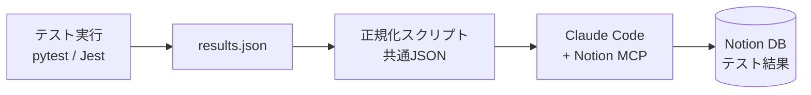
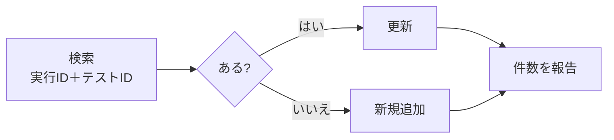

## はじめに

テストを回したあと、結果を Excel や Notion に**手でコピペ**していませんか？

- 転記ミスで「本当に合っているのか」が不安になる
- テストが増えるほど、転記が地味に重くなる
- 「いつ・どの環境・どのコミットで落ちたか」が後から追えない

この記事では、**Windows + VSCode + Claude Code + Notion MCP** で、テスト結果を Notion の DB に**重複なく自動記録**する仕組みの作り方をまとめます。pytest（Python）と Jest（Node.js）の**両方**に対応します。

対象読者は、テスト担当・QA・DX推進のエンジニアです。

:::message
Notion MCP の接続手順や画面、pytest・Jest の出力形式は更新されることがあります（本記事は 2026年11月時点の内容）。実施前に公式ドキュメントで最新を確認してください。
:::

## 完成イメージ



ポイントは、**テストと Notion の間に「共通JSON」を挟む**ことです。

| 層 | 役割 |
|---|---|
| テスト | 結果を出すだけ |
| 共通JSON | pytest と Jest の出力差を吸収する |
| Claude Code | 読み取り・判断・Notionへの登録 |
| Notion | 蓄積・検索・共有 |

テストの言語が変わっても、共通JSONさえ同じなら後ろは作り直さずに済みます。

## 1. 環境（Windows）

最低限、次が動けば OK です。

| ツール | 確認コマンド |
|---|---|
| VSCode | `code --version` |
| Node.js (LTS) | `node -v` / `npm -v` |
| Python 3.x | `python --version` |
| Git | `git --version` |
| Claude Code | `claude --version` |

Windows でつまずきやすい点は 4 つです。

| 症状 | 原因 | 対処の方向 |
|---|---|---|
| スクリプトが実行できない | PowerShell の実行ポリシー | 社内規程を確認して、現在のユーザー範囲で緩和 |
| コマンドが見つからない | PATH が未反映 | ターミナル／VSCode を再起動 |
| 日本語が文字化けする | 文字コード不一致 | UTF-8 に統一 |
| パスや改行で失敗する | `\` と `/`、CRLF と LF | パス操作は標準APIで、改行は Git 設定で統一 |

## 2. Notion MCP に接続する

MCP は「AI と外部ツールの共通コネクタ」です。Claude Code から Notion を操作できるようにします。

```powershell
claude mcp add --transport http --scope user notion https://mcp.notion.com/mcp
```

登録後、Claude Code を起動して `/mcp` を実行し、ブラウザで Notion にログインして認可します。

:::message alert
**認証画面では、ワークスペース名を必ず確認**してください（業務用と個人用の取り違え防止）。許可するのは「テスト結果」DB（またはその親ページ）だけにします。
:::

`--scope user` を付けないと、登録したフォルダ限定になります。翌日に別のフォルダで Claude Code を起動して `/mcp` が空に見えるときは、まずここを疑ってください。

## 3. Notion の DB を設計する

DB 名は「テスト結果」。**1テスト＝1行**です。プロパティ名と型は、書き込み失敗を防ぐために一字一句そろえます（全角・半角も）。

| プロパティ名 | 型 | 例 |
|---|---|---|
| テスト名 | タイトル | 足し算が正しい |
| テストID | テキスト | `test_calc.py::test_add` |
| 実行ID | テキスト | `20261112-1000-a1b2c3d` |
| 結果 | セレクト | PASS / FAIL / SKIP |
| 実行日時 | 日付 | 2026-11-12 10:00 |
| 環境 | セレクト | local-win11 / ci |
| コミット | テキスト | `a1b2c3d` |
| 所要時間(ms) | 数値 | 12 |
| 失敗ログ | テキスト | 先頭500文字のみ |
| フレームワーク | セレクト | pytest / Jest |

結果を PASS / FAIL / SKIP の**3値に絞る**のがコツです。集計と検索が安定します。

作り方は 2 通りあります。

- CSV をインポートして、型を手動で直す（ヘッダーだけの CSV で OK）
- Claude Code に「このプロパティで DB を作って」と頼む（作成後に一覧を見せてもらう）

## 4. テストを実行して JSON を出す

### pytest

```powershell
pip install pytest pytest-json-report
pytest --json-report --json-report-file=results.json
```

### Jest

```powershell
npm i -D jest
npx jest --json --outputFile=results.json
```

どちらも失敗するテストを 1 つ入れておくと、**FAIL の記録**まで確認できます。

## 5. 共通JSONに正規化する

pytest と Jest では JSON の形が違います。次の共通スキーマにそろえます。

```json
{
  "run_id": "20261112-1000-a1b2c3d",
  "env": "local-win11",
  "commit": "a1b2c3d",
  "framework": "pytest",
  "executed_at": "2026-11-12T10:00:00+00:00",
  "summary": { "total": 4, "pass": 2, "fail": 1, "skip": 1 },
  "tests": [
    { "id": "test_calc.py::test_add", "name": "test_add", "result": "PASS", "duration_ms": 12, "error": null }
  ]
}
```

| 項目 | pytest | Jest |
|---|---|---|
| ID | `nodeid` | ファイル名 + `::` + `fullName` |
| 結果 | `outcome`（passed→PASS、failed/error→FAIL、他→SKIP） | `status`（passed→PASS、failed→FAIL、pending/todo→SKIP） |
| 所要時間 | setup+call+teardown（秒→ms） | `duration`（ms） |
| 失敗ログ | `longrepr` | `failureMessages` を結合 |

変換スクリプトは次のとおりです。**失敗ログの先頭500文字への切り詰め**と、**メール・トークン・ホームディレクトリのマスク**も入れています。

:::details normalize_results.py（全文）
```python:normalize_results.py
#!/usr/bin/env python3
"""pytest-json-report / Jest(--json) の出力を、共通スキーマ(results.normalized.json)に正規化する。

使い方:
  python normalize_results.py results.json --env local-win11 --out results.normalized.json
  オプション: --framework auto|pytest|jest  --commit <hash>  --run-id <id>  --max-log 500

共通スキーマ:
  {run_id, env, commit, framework, executed_at, summary{total,pass,fail,skip},
   tests:[{id, name, result(PASS/FAIL/SKIP), duration_ms, error}]}
"""
import argparse
import json
import re
import subprocess
import sys
from datetime import datetime, timezone

MASKS = [
    (re.compile(r"(?:[A-Za-z]:[\\/]Users[\\/]|/home/|/Users/)[^\\/\s]+"), "[HOME]"),
    (re.compile(r"[\w.+-]+@[\w-]+\.[\w.-]+"), "[EMAIL]"),
    (re.compile(r"(?i)bearer\s+[A-Za-z0-9._\-]+"), "Bearer [TOKEN]"),
    (re.compile(r"\b(?:secret|ntn|sk|ghp|xox[bp])[_-][A-Za-z0-9_\-]{8,}"), "[TOKEN]"),
    (re.compile(r"(?i)(password|passwd|token|api[_-]?key)\s*[=:]\s*\S+"), r"\1=[MASKED]"),
]


def mask(text, max_len):
    if not text:
        return None
    for pat, rep in MASKS:
        text = pat.sub(rep, text)
    text = text.strip()
    return text[:max_len] + ("…" if len(text) > max_len else "")


def to_result(status):
    s = (status or "").lower()
    if s in ("passed", "xpassed"):
        return "PASS"
    if s in ("failed", "error"):
        return "FAIL"
    return "SKIP"  # skipped / pending / todo / xfailed / その他


def from_pytest(data, max_log):
    tests = []
    for t in data.get("tests", []):
        stages = [t.get(k) or {} for k in ("setup", "call", "teardown")]
        dur = sum((st.get("duration") or 0) for st in stages)
        res = to_result(t.get("outcome"))
        err = None
        if res == "FAIL":
            for st in stages:
                if st.get("outcome") == "failed":
                    crash = st.get("crash") or {}
                    err = st.get("longrepr") or crash.get("message")
                    break
        nodeid = t.get("nodeid", "")
        tests.append({
            "id": nodeid,
            "name": nodeid.split("::")[-1],
            "result": res,
            "duration_ms": int(round(dur * 1000)),
            "error": mask(err, max_log),
        })
    return tests


def from_jest(data, max_log):
    tests = []
    for f in data.get("testResults", []):
        fname = (f.get("name") or "").replace("\\", "/").split("/")[-1]
        asserts = f.get("assertionResults", [])
        if not asserts and f.get("status") == "failed":  # テストファイル自体の失敗
            tests.append({"id": fname, "name": fname, "result": "FAIL", "duration_ms": 0,
                          "error": mask(f.get("message"), max_log)})
        for a in asserts:
            res = to_result(a.get("status"))
            full = a.get("fullName") or a.get("title") or ""
            tests.append({
                "id": f"{fname}::{full}",
                "name": a.get("title") or full,
                "result": res,
                "duration_ms": int(round(a.get("duration") or 0)),
                "error": mask("\n".join(a.get("failureMessages") or []), max_log) if res == "FAIL" else None,
            })
    return tests


def detect(data):
    if "testResults" in data:
        return "jest"
    if "tests" in data and ("summary" in data or "created" in data):
        return "pytest"
    raise SystemExit("形式を判別できません。--framework で pytest か jest を指定してください。")


def git_commit():
    try:
        return subprocess.check_output(["git", "rev-parse", "--short", "HEAD"], stderr=subprocess.DEVNULL, text=True).strip()
    except Exception:
        return "unknown"


def main():
    ap = argparse.ArgumentParser(description=__doc__, formatter_class=argparse.RawDescriptionHelpFormatter)
    ap.add_argument("input")
    ap.add_argument("--framework", default="auto", choices=["auto", "pytest", "jest"])
    ap.add_argument("--env", default="local-" + sys.platform)
    ap.add_argument("--commit", default=None)
    ap.add_argument("--run-id", default=None)
    ap.add_argument("--max-log", type=int, default=500)
    ap.add_argument("--out", default="results.normalized.json")
    a = ap.parse_args()

    with open(a.input, encoding="utf-8") as fh:
        data = json.load(fh)
    fw = detect(data) if a.framework == "auto" else a.framework
    tests = from_pytest(data, a.max_log) if fw == "pytest" else from_jest(data, a.max_log)

    now = datetime.now(timezone.utc)
    commit = a.commit or git_commit()
    run_id = a.run_id or f"{now:%Y%m%d-%H%M}-{commit[:7]}"
    count = lambda r: sum(1 for t in tests if t["result"] == r)
    out = {
        "run_id": run_id, "env": a.env, "commit": commit, "framework": fw,
        "executed_at": now.isoformat(timespec="seconds"),
        "summary": {"total": len(tests), "pass": count("PASS"), "fail": count("FAIL"), "skip": count("SKIP")},
        "tests": tests,
    }
    with open(a.out, "w", encoding="utf-8") as fh:
        json.dump(out, fh, ensure_ascii=False, indent=2)
    s = out["summary"]
    print(f"{fw}: total={s['total']} PASS={s['pass']} FAIL={s['fail']} SKIP={s['skip']} -> {a.out}")


if __name__ == "__main__":
    main()
```
:::

実行例です。

```powershell
python normalize_results.py results.json --env local-win11 --out results.normalized.json
```

pytest と Jest の実際の出力（成功2・失敗1・スキップ1の4件ずつ）に対して実行し、どちらも次のように正規化されることを確認しました。

```text
pytest: total=4 PASS=2 FAIL=1 SKIP=1 -> results.normalized.json
jest: total=4 PASS=2 FAIL=1 SKIP=1 -> results.normalized.json
```

:::message
失敗メッセージにテスト内のメールアドレスや `token=...` を入れておいたところ、`[EMAIL]` と `token=[MASKED]` に置き換わりました。ログを Notion に送る前の**機械的なマスク**は、人の注意力に頼らないための保険です。ただし完全ではないので、社内の機密区分に合わせて追加してください。
:::

## 6. Claude Code に「更新 or 追加」で登録させる

登録は Claude Code に頼みます。ここで大事なのは**条件を明文化する**ことです。

```text
results.normalized.json を読み、Notionの「テスト結果」DBに登録して。
・実行ID とテストID が同じ行があれば更新、なければ新規追加
・FAIL は失敗ログを先頭500文字だけ入れる
・最後に「追加N件／更新N件／失敗N件」と、PASS/FAIL/SKIP の件数突合を報告
```

### 冪等性（再実行しても行が増えない）



キーは「**実行ID ＋ テストID**」です。同じ結果をもう一度登録して、**行が増えなければ成功**です。

:::message
最初は 1 件だけ登録して、Notion 上で結果を目で確認してください。件数は必ず**人が突合**します。「合っています」とだけ報告されたら、Notion 側の件数も見る習慣を付けましょう。
:::

## 7. 手順を「スキル」と「コマンド」にする

毎回プロンプトを貼るのは大変です。手順を **Claude に読ませるスキル**として保存すると、「テスト結果をNotionに記録して」だけで、同じ手順が再現されます。

スキルの構成です。

```text
notion-test-recorder/
├── SKILL.md                      # 手順・守るルール（Claudeが読む）
├── scripts/normalize_results.py  # 共通JSONへの変換
├── references/
│   ├── schema.md                 # 共通JSONスキーマ
│   └── notion-db-template.md     # DBの定義とDB作成プロンプト
└── templates/
    ├── test-results-template.csv # NotionにインポートするDBひな形
    ├── run-page-template.md      # 1回の実行をまとめるページ
    └── record-tests.md           # スラッシュコマンド用
```

`SKILL.md` の中心は、次の流れです。

1. **前提チェック**：Notion MCP の接続、認証先ワークスペース、触ってよい範囲（「テスト結果」DBのみ）
2. **正規化**：`normalize_results.py` を実行
3. **DB特定**：なければ作成してよいか確認（プロパティ名・型を一字一句そろえる）
4. **登録**：まず 1 件で確認 → 実行ID＋テストIDで更新／追加
5. **報告**：追加・更新・失敗の件数、PASS/FAIL/SKIP の突合

さらに、`.claude/commands/record-tests.md` を置くと、**1コマンド**で呼べます。

```markdown
---
description: テスト結果（results.json）をNotionの「テスト結果」DBに記録する
---

notion-test-recorder スキルの手順で、`$ARGUMENTS`（未指定なら `results.json`）の結果を
Notion の「テスト結果」DB に記録してください。
```

毎回の運用はこれだけです。

1. テストを実行して `results.json` を出す
2. Claude Code で `/record-tests` を実行
3. Notion で件数（追加・更新・失敗）を確認

## 8. 自動化は 3 段階で育てる

| 段階 | 内容 |
|---|---|
| ① スラッシュコマンド | 手順を 1 コマンドに |
| ② hooks | 作業の区切りなど、決まったタイミングで自動実行 |
| ③ スケジュール / CI | 夜間実行や CI からの呼び出し |

③ の無人実行では、**認証と権限の扱い**が難しくなります。対話で使う方法をそのまま CI に持ち込まず、設計を分けて考えてください。

## 9. 法人で運用するときの 4 原則

| 原則 | 内容 |
|---|---|
| 最小権限 | 許可するのは対象 DB だけ。ワークスペース全体は開けない |
| 秘密情報を残さない | トークンをリポジトリに入れない（`.gitignore`・環境変数） |
| 機密を送らない | 個人情報・顧客データはマスクしてから。迷ったら送らない |
| 社内規程の確認 | Notion に保存してよい情報区分と、外部サービスの利用承認 |

運用チェックリストは次のとおりです。

- 登録件数が、テスト件数と一致している
- FAIL の行に失敗ログが入っている（先頭500文字・マスク済み）
- 書き込みに失敗しても、`results.json` はローカルに残している
- リトライは回数に上限を決め、失敗は人に通知する

## つまずき早見表

| 症状 | 原因の候補 | 対応 |
|---|---|---|
| `/mcp` が空 | 登録がフォルダ限定 | `--scope user` で登録し直す |
| 認証がうまくいかない | 別ワークスペースにログイン中 | アカウントを確認して `/mcp` で再認証 |
| DB が見つからない | 許可範囲が狭い | 許可ページに DB（または親ページ）を追加 |
| 書き込みが失敗する | プロパティ名・型の不一致 | DB の定義と見比べる |
| 行が重複する | 更新条件が曖昧 | 「実行ID＋テストID」で必ず検索してから書く |
| JSON が出ない（pytest） | プラグイン未導入 | `pytest-json-report` を入れる |

## おわりに

テスト結果は、**溜めて・探して・共有できる資産**になります。ポイントを 3 つにまとめます。

1. **共通JSON**で、テスト言語の差を吸収する
2. **冪等な更新**（実行ID＋テストID）で、何度回しても安心にする
3. **最小権限と機密の線引き**を、最初から決めておく

まずは「HelloNotion」という 1 行を書き込むところから試してみてください。成功すると、後は手順を積み上げるだけです。

最後まで読んでいただき、ありがとうございました。🐰
